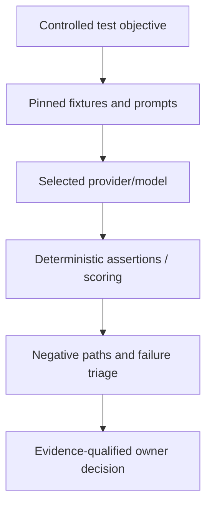

# Fork qualification notes — deterministic LLM evaluations

**Scope:** public Promptfoo evaluation/red-teaming reference. This note is not a live security scanner deployment.

Use local/offline fixtures where possible, pinned model/seed and sanitized test corpora. The tested boundary must distinguish prompt quality, authorization escape, tool-call behavior, source provenance and actual destination effects. Avoid sending private project content to a hosted evaluator without separate consent and data-boundary verification. Results do not grant model agents higher task authority or replace source/runtime regression tests.

This fork is an evaluation primitive for qualified adoption, not a guarantee of comprehensive jailbreak resistance or reliable performance. Retain upstream license/notice and release only original public-safe fixtures.
